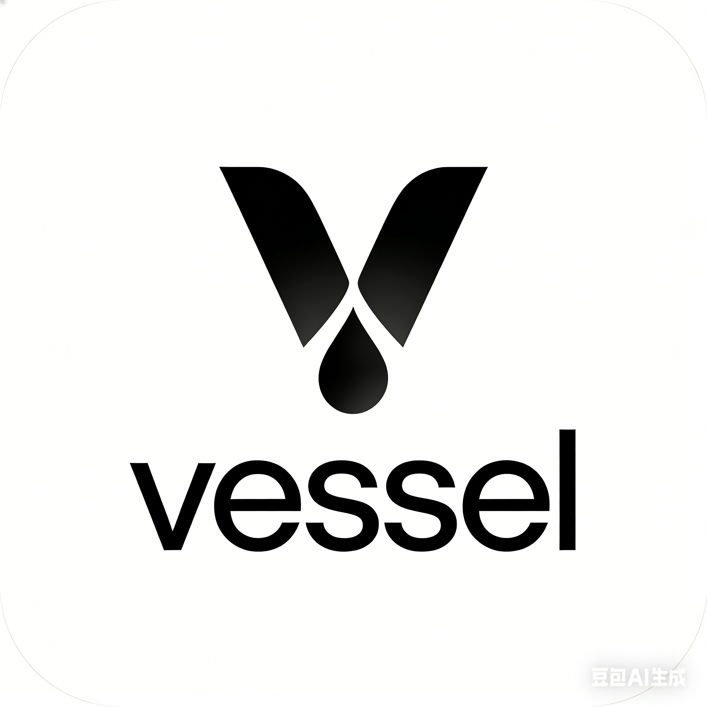

<p align="center">
  
</p>

# Vessel

基于 Electron、React 和 TypeScript 的本地优先桌面工作台，将笔记、文件管理、浏览器与常用工具放在同一个工作区。

## 功能

- **工作区与编辑器**：目录树、文件标签、Markdown 编辑、代码编辑、全文搜索、图片预览及 Obsidian Bases 只读表格。
- **浏览器**：独立浏览会话、历史记录、扩展管理与代理配置；扩展能力受 Electron 支持范围限制。
- **图片工具箱**：缩放、裁剪、旋转、标注、格式转换、压缩、水印、OCR 和本地背景移除。
- **办公文档**：集成 ONLYOFFICE 文档预览与编辑。
- **同步与备份**：S3 存储、双向增量同步、定时同步、排除规则、冲突处理及日志检查。
- **开发工具**：JSON 格式化、颜色转换、Base64、URL 编解码、控制台与 SQLite 数据查看。
- **其他工具**：Git、API 客户端、待办和文件中转站。

## 开始开发

环境要求：Node.js 20.20 或更高版本、pnpm 10。项目使用 pnpm workspace，请在仓库根目录执行命令。

```sh
pnpm install
pnpm run assets:matting
pnpm run dev
```

安装包含 Electron 和原生模块准备步骤。首次安装及准备换底模型需要网络；换底模型准备完成后随应用打包，运行时使用本地资源。

ONLYOFFICE 需要另外准备体积较大的运行资源，步骤见 [Office 资源说明](resources/office-README.md)。模型与 Office 运行资源不提交到 Git，构建前需要准备完整。

## 常用命令

| 命令                         | 用途                                              |
| ---------------------------- | ------------------------------------------------- |
| `pnpm run dev`               | 启动开发模式                                      |
| `pnpm run format`            | 格式化项目文件                                    |
| `pnpm run check:conventions` | 检查别名、路由组件归属、函数文档和 workspace 命名 |
| `pnpm run typecheck`         | 检查应用和各 workspace 包的 TypeScript 类型       |
| `pnpm test -- run`           | 运行全部测试                                      |
| `pnpm run build`             | 类型检查并构建应用                                |
| `pnpm run build:sync`        | 构建同步 npm 包                                   |
| `pnpm run build:clipper`     | 构建网页剪藏扩展                                  |
| `pnpm run build:mac`         | 构建 macOS 安装包                                 |
| `pnpm run build:win`         | 构建 Windows 安装包                               |
| `pnpm run build:linux`       | 构建 Linux 安装包                                 |

原生模块需要与目标平台及 Electron ABI 匹配；更换 Electron 版本后可执行 `pnpm run rebuild:deps`。macOS 文件监听测试使用 FSEvents，需要允许测试进程访问文件系统。

## 项目结构

```text
src/
  main/                 Electron 主进程及桌面服务
  preload/              隔离环境中的 IPC API
  renderer/
    src/
      pages/            路由入口及各路由私有组件
      components/       跨一级路由共用组件
      features/         Office、截图等独立窗口功能
      lib/              应用适配和基础模块
      router/           路由配置
packages/               workspace 包
scripts/                构建、资源准备、检查及 smoke 脚本
tests/                  主进程和渲染进程测试
resources/              桌面及 Office 运行资源
docs/                   功能文档和工程规范
```

### Workspace 包

npm 包名与源码目录名分别管理，业务代码通过包名或别名导入。

| 包名                    | 职责                         |
| ----------------------- | ---------------------------- |
| `@vessel/clipper`       | 网页剪藏扩展                 |
| `@vessel/image-matting` | 本地图片背景移除引擎适配     |
| `@vessel/obsidian`      | Obsidian / Markdown 兼容能力 |
| `@vessel/react-router`  | 应用路由适配                 |
| `@vessel/sync`          | 增量同步引擎、规则和存储适配 |
| `@vessel/type`          | 公共类型和跨进程契约         |
| `@vessel/utils`         | 公共工具函数                 |

## 开发约定

- 路由入口使用 `pages/<route>/index.tsx`；私有组件放在该路由的 `components` 中。
- 子路由之间共用的组件放到最近公共父路由的 `components`；跨一级路由的组件放到 `src/components`。
- 一个文件只定义一个 JSX 组件；纯类型、常量及不含 JSX 的工具模块使用 `.ts`。
- 公共函数与类型分别归入 `@vessel/utils`、`@vessel/type`；命名函数补充 JSDoc，函数之间保留空行。
- 模块导入使用 `@/`、`@main/`、`@preload/` 或 workspace 别名。资源 URL 和注入外部页面的代码遵循其运行环境的 URL 规则。
- 修改目录、别名或包导出时，同步检查 TypeScript、Vite、Vitest、Node 脚本及打包路径。

完整规则见 [Workspace 与目录规范](docs/architecture/workspace-organization.md)。早期脚手架安装记录已归档到 [工程初始化历史](docs/history/project-bootstrap.md)。

## 主要技术

Electron 39、React 19、TypeScript 5、electron-vite、Tailwind CSS 3、shadcn/ui / Radix UI、React Router、Zustand、Vditor、Monaco Editor 和 SQLite。

图片换底依赖 IMG.LY / IS-Net，Office 和其他第三方模块也有各自的许可证。分发前请核对对应依赖及资源的授权和第三方声明。
