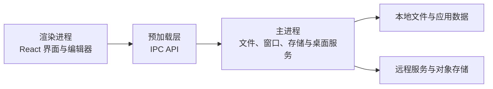

<p align="center">
  
</p>

<h1 align="center">Vessel</h1>

<p align="center">本地优先的桌面工作台，让知识、文件与工具在同一个工作区中协作。</p>

<p align="center">
  <a href="#核心能力">核心能力</a> ·
  <a href="#快速开始">快速开始</a> ·
  <a href="#工程架构">工程架构</a> ·
  <a href="#构建与分发">构建与分发</a> ·
  <a href="#参与开发">参与开发</a>
</p>

Vessel 基于 **Electron、React 和 TypeScript** 构建，将 Markdown 笔记、文件管理、思维导图、内置浏览器及开发工具整合到桌面应用中。以本地工作区为入口，按需连接远程存储，减少阅读、编辑和整理资料时在多个应用之间切换的成本。

## 核心能力

### 知识编辑与文件管理

- **Markdown 编辑**：基于 Vditor 的即时渲染，支持标题、列表、任务项、代码块、表格及快捷插入菜单。
- **文档导航**：多标签编辑、面包屑、分层目录、标题折叠与阅读位置定位。
- **脚注**：为选中文字添加说明，通过悬浮卡片查看，也可在右侧栏目集中浏览、定位和删除。
- **工作区文件树**：文件与文件夹管理、多选移动、拖拽、重命名，以及按文件类型创建文件。
- **搜索**：查找整个工作区中的文件和文件夹，支持结果计数与分批加载；另提供内容搜索能力。
- **Obsidian 兼容**：支持双向链接、图片引用、Frontmatter，以及 Bases 只读表格等能力。具体范围见 [Obsidian 兼容模块](packages/@vessel/obsidian/README.md)。
- **扩展内容**：代码编辑、图片预览、思维导图、Excalidraw 白板，以及自定义表格和步骤组件。

### 阅读、标注与图片处理

- **PDF 阅读与标注**：浏览、缩放、画笔、擦除、撤销，本地保存笔迹，并导出带标注的 PDF。
- **Office 文档**：通过本地 ONLYOFFICE / WASM 运行资源预览和编辑办公文档，无需另行部署文档服务器。
- **图片工具箱**：裁剪、缩放、旋转、标注、格式转换、压缩、水印、OCR 和本地背景移除。
- **图片插入**：支持从本机选择、读取当前剪贴板图片及直接粘贴图片。

Office 的字体、格式兼容性和编辑能力取决于上游运行资源；Obsidian 兼容功能不等同于完整实现其插件生态。

### 浏览与开发工具

| 模块       | 能力                                                                  |
| ---------- | --------------------------------------------------------------------- |
| 内置浏览器 | 标签页、独立浏览会话、历史记录、扩展管理与代理配置                    |
| 网页剪藏   | 独立浏览器扩展，见 [网页剪藏模块](packages/@vessel/clipper/README.md) |
| Git 工作台 | 暂存、提交、历史与差异查看、分支、合并、贮藏、推送、拉取和抓取        |
| 终端       | 在工作区或仓库目录中使用内置终端                                      |
| API 客户端 | 在应用内组织和发送接口请求                                            |
| 开发工具   | JSON 格式化、颜色转换、Base64、URL 编解码、控制台与 SQLite 数据查看   |
| 日常整理   | 待办、日历和文件中转站                                                |

浏览器扩展受 Electron 支持范围限制，不能保证所有 Chrome 扩展都能运行。

### 同步与备份

通过 `@vessel/sync` 将本地工作区与 S3 兼容对象存储连接，支持双向增量同步、单向上传或下载、同步预览、定时同步、排除规则、冲突策略及日志查看。

- **增量检查**：结合本地指纹、内容摘要、远端信息和同步记录生成操作计划。
- **传输控制**：并发传输、S3 分片上传、进度反馈与取消。
- **冲突处理**：提供保留较新版本、保留双方、保留较大文件和报告冲突等策略；符合条件的 Markdown 正文可尝试三方合并。
- **删除保护**：是否传播删除由配置决定；双方存在并发修改时按同步策略处理。
- **编辑容错**：同步期间文件发生变化或重命名时，跳过受影响文件，留待后续同步处理。

配置入口位于应用的“设置 → 同步与备份”。使用前需准备自己的存储端点、Bucket、区域及访问凭据。同步规则、适配接口和使用示例见 [同步引擎文档](packages/@vessel/sync/README.md)。

## 快速开始

### 环境要求

| 项目     | 要求                                                       |
| -------- | ---------------------------------------------------------- |
| Node.js  | 20.20 或更高版本                                           |
| 包管理器 | pnpm 10，使用仓库根目录的 workspace 配置                   |
| 桌面环境 | 可运行 Electron 的 macOS、Windows 或 Linux                 |
| 原生依赖 | Electron、SQLite、PTY 和文件监听模块需要匹配目标平台与架构 |

仓库提供三个平台的构建入口；这不代表每个平台、架构及功能组合均已完成验证。

### 安装并启动

在仓库根目录执行：

```sh
pnpm install
pnpm run assets:matting
pnpm run dev
```

`pnpm install` 会通过安装后脚本准备 Electron 原生依赖、PTY、Monaco 本地化和截图插件。首次安装与背景移除资源准备需要网络。背景移除模型准备完成后随应用打包，运行时使用本地资源。

启动后选择一个本地文件夹作为工作区，即可浏览文件、打开文档和创建内容。远程同步需要在设置中单独配置。

### 准备 Office 运行资源

Office 资源体积较大，不随 Git 仓库提交。按照 [Office 资源说明](resources/office-README.md) 下载并放入指定目录后，执行：

```sh
node scripts/prepare-office.cjs
```

在新机器构建或分发前，请确认 Office 运行资源、背景移除模型及所需 OCR 资源完整。不要将凭据或个人工作区内容提交到仓库。

## 常用命令

所有命令均在仓库根目录执行。

| 命令                         | 用途                                    |
| ---------------------------- | --------------------------------------- |
| `pnpm run dev`               | 启动开发模式并监听主进程构建变化        |
| `pnpm run start`             | 预览已构建的应用                        |
| `pnpm run typecheck`         | 检查应用及脚本中列出的 workspace 包类型 |
| `pnpm run typecheck:web`     | 检查渲染进程类型                        |
| `pnpm run typecheck:node`    | 检查主进程和预加载代码类型              |
| `pnpm run lint`              | 执行 ESLint 检查                        |
| `pnpm run check:conventions` | 检查源码约定与组件边界                  |
| `pnpm test -- run`           | 运行测试                                |
| `pnpm run format`            | 格式化整个仓库                          |
| `pnpm run build`             | 执行类型检查并构建应用                  |
| `pnpm run build:unpack`      | 构建未封装为安装器的应用目录            |
| `pnpm run build:sync`        | 构建独立同步包                          |
| `pnpm run build:clipper`     | 构建网页剪藏扩展                        |
| `pnpm run rebuild:deps`      | 按当前 Electron 版本重建原生依赖        |

测试按主进程 / Node 与渲染进程 / jsdom 划分。根目录测试脚本使用 Electron 的 Node 模式，以匹配应用的原生模块环境。macOS 文件监听测试依赖 FSEvents，受限沙箱可能影响测试结果。

只验证某一功能时，可以指定测试文件：

```sh
pnpm test -- run tests/renderer/link-tooltip.test.tsx
```

## 工程架构

应用采用 Electron 的主进程、预加载与渲染进程分层，跨进程能力通过 IPC API 提供。



### 目录结构

```text
src/
  main/                 Electron 主进程与模块服务
  preload/              预加载入口、IPC API 与类型声明
  renderer/
    src/
      pages/            路由入口及路由私有组件
      components/       共用界面、编辑器与工作区组件
      features/         Office、截图等独立窗口功能
      lib/              应用适配与基础模块
      router/           路由配置
packages/@vessel/        可复用 workspace 包
scripts/                构建、资源准备、规范检查和 smoke 脚本
tests/                  主进程与渲染进程测试
resources/              桌面及 Office 运行资源
docs/                   功能说明、架构约定与工程记录
```

### Workspace 包

| 包                                                                    | 职责                                   |
| --------------------------------------------------------------------- | -------------------------------------- |
| [`@vessel/obsidian`](packages/@vessel/obsidian/README.md)             | Markdown / Obsidian 兼容解析与相关交互 |
| [`@vessel/sync`](packages/@vessel/sync/README.md)                     | 独立 Node.js 同步引擎、规则与存储适配  |
| [`@vessel/markdown-table`](packages/@vessel/markdown-table/README.md) | 自定义 Markdown 表格组件               |
| [`@vessel/markdown-steps`](packages/@vessel/markdown-steps/README.md) | Markdown 步骤组件                      |
| [`@vessel/clipper`](packages/@vessel/clipper/README.md)               | 网页剪藏浏览器扩展                     |
| [`@vessel/image-matting`](packages/@vessel/image-matting/README.md)   | 本地图片背景移除引擎适配               |
| [`@vessel/react-router`](packages/@vessel/react-router/README.md)     | 应用路由适配                           |
| `@vessel/type`                                                        | 公共类型与跨进程契约                   |
| [`@vessel/utils`](packages/@vessel/utils/README.md)                   | 公共工具函数                           |

主要技术包括 Electron、React、TypeScript、electron-vite、Tailwind CSS、shadcn/ui / Radix UI、React Router、Zustand、Vditor、Monaco Editor、Mind Elixir 与 SQLite。具体版本以各包的 `package.json` 和锁文件为准。

## 构建与分发

```sh
# macOS
pnpm run build:mac

# Windows
pnpm run build:win

# Windows ARM64
pnpm run build:win:arm64

# Linux
pnpm run build:linux
```

打包前建议先执行 `pnpm run typecheck` 和相关测试。`build:mac`、`build:linux` 的脚本没有串联完整类型检查；`build:win` 会先执行 `build`。安装包构建成功也不等于完成目标系统上的运行验证。

原生模块需要与目标系统、CPU 架构及 Electron ABI 匹配。升级 Electron 或切换开发环境后，可先执行 `pnpm run rebuild:deps`。签名、公证及发布凭据应由分发环境配置。

## 参与开发

1. 基于要修改的功能范围创建分支，避免混入无关变更。
2. 遵循现有的目录归属、别名与跨进程契约，补充有必要的回归测试。
3. 执行相关类型检查、测试与规范检查；涉及界面的修改还需在应用中验证实际效果。
4. 提交说明中写清问题、变更行为、验证结果和仍存在的限制。

项目约定包括：

- 路由入口使用 `pages/<route>/index.tsx`，私有组件归属对应路由。
- 共用组件放到最近的公共层级；每个模块最多定义一个 JSX 组件。
- 纯类型、常量和无 JSX 的工具模块使用 `.ts`。
- 公共函数和类型分别归入 `@vessel/utils`、`@vessel/type`，命名函数补充 JSDoc。
- 模块导入使用应用或 workspace 别名；修改包导出时同步检查 TypeScript、Vite、Vitest 与打包路径。

详细规则见 [Workspace 与目录规范](docs/architecture/workspace-organization.md)。

## 文档与授权

- [同步引擎](packages/@vessel/sync/README.md)
- [Obsidian 兼容能力](packages/@vessel/obsidian/README.md)
- [网页剪藏扩展](packages/@vessel/clipper/README.md)
- [Office 资源准备](resources/office-README.md)
- [本地背景移除](packages/@vessel/image-matting/README.md)
- [工程初始化历史](docs/history/project-bootstrap.md)

应用引用的第三方代码、模型、字体和运行资源保留各自的许可证。ONLYOFFICE、IMG.LY / IS-Net 等组件与资源的使用、修改和分发要求应分别核对；仓库源码可见不代表所有组成部分具有相同授权。对外分发前，请补齐适用的授权说明与第三方声明。
